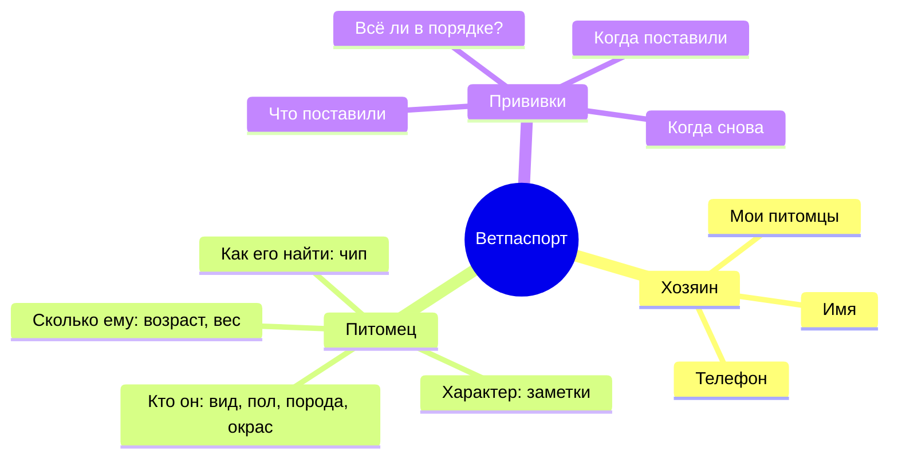
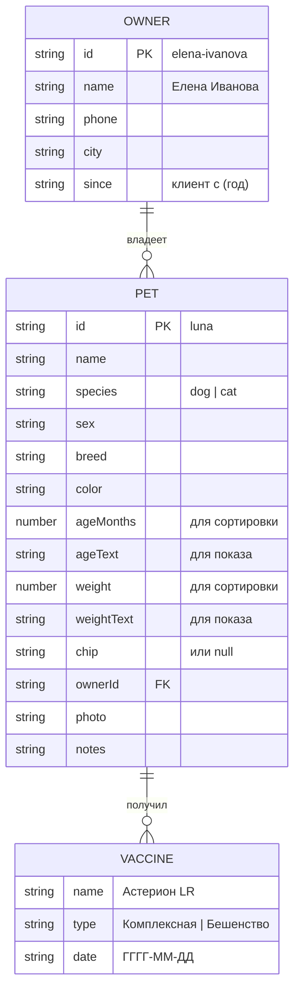

# 4. Ментальная модель пользователя и модель данных

## 4.1. Ментальная модель

Как пользователь сам представляет себе предметную область: **«У хозяина есть питомцы, у каждого питомца есть свой паспорт, в паспорте — прививки и особые отметки»**. Приложение повторяет это представление: разделы «Хозяева» и «Питомцы», карточка питомца выглядит как страница паспорта.

| Понятие в голове пользователя | Как отражено в интерфейсе |
|---|---|
| «Мои животные» | Страница хозяина с каруселью его питомцев |
| «Паспорт питомца» | Страница питомца: фото, сведения, таблица прививок, заметки |
| «Пора на прививку?» | Цветной статус: зелёный — в порядке, оранжевый — скоро, красный — просрочена |
| «Найти кошку / самого старшего» | Фильтры и сортировка на странице «Питомцы» |
| «Где я сейчас?» | Хлебные крошки и подсветка пункта меню |

## 4.2. Модель данных

Данные статические и лежат в `project/js/data.js`.

### Вычисляемые данные (в `views.js`)

| Поле | Как вычисляется |
|---|---|
| `next` — дата ревакцинации | `date` + 1 год |
| `status` прививки | `overdue`, если `next` < сегодня; `soon`, если до `next` ≤ 60 дней; иначе `ok` |
| статус питомца | худший из статусов его прививок |
| питомцы хозяина | `pets.filter(pet => pet.ownerId === owner.id)` |

### Данные в базе

| Питомец | Вид | Хозяин | Прививки |
|---|---|---|---|
| Луна | мопс | Елена Иванова | Астерион DHPPI, Астерион LR — 07.09.2026 |
| Лорд | тибетский мастиф | Елена Иванова | Астерион DHPPI, Астерион LR — 09.09.2026 |
| Лаки | хаски | Антон Татыржа | Нобивак DHPPi, Нобивак Rabies — 15.03.2026 |
| Милка | кошка без породы | Ксения Румянцева | Мультифел-4, Рабикан — 20.11.2025 |
| Ричард | чихуахуа | Глотов Елисей | Нобивак DHPPi, Нобивак Rabies — 05.05.2026 |
| Рыжик | сибирский кот | Иутинский Дмитрий | Астерион LR — 10.08.2025 |
