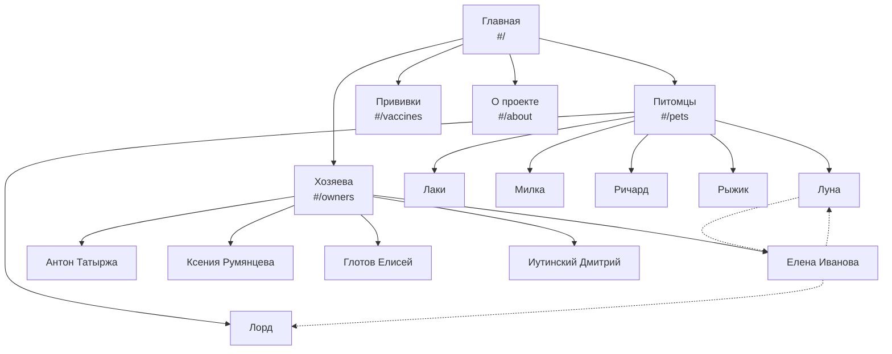

# 5. Структура и навигация

## 5.1. Карта сайта



Сплошные линии — иерархия разделов, пунктир — перекрёстные ссылки (хозяин ↔ питомец).

## 5.2. Структура файлов

```
project/
├── index.html        — каркас: header, nav, main, footer
├── css/styles.css    — стили и адаптив (брейкпоинт 760px)
├── img/              — фото питомцев
└── js/
    ├── data.js       — питомцы, хозяева, карта сайта (siteMap)
    ├── dom.js        — фабрика элементов el()
    ├── router.js     — createRoute, flatten, getTrail, класс Router
    ├── views.js      — функции отрисовки страниц
    └── main.js       — меню, хлебные крошки, бургер, запуск роутера
```

## 5.3. Как устроена маршрутизация

1. `siteMap` в `data.js` описывает дерево страниц. Страницы питомцев и хозяев генерируются из массивов `pets` и `owners`.
2. `createRoute` превращает дерево в маршруты с полями `path`, `segments`, `parent`.
3. `Router` слушает событие `hashchange`, ищет маршрут по пути (`#/pets/luna` → `/pets/luna`) и вызывает `renderPage`.
4. `renderPage` выбирает функцию из `views` по полю `view`, обновляет заголовок вкладки, подсветку меню и хлебные крошки. Неизвестный адрес → страница 404.

## 5.4. Навигационные элементы

| Элемент | Где | Поведение |
|---|---|---|
| Логотип «🐾 Ветпаспорт» | шапка | ведёт на главную |
| Главное меню | шапка | 4 раздела; текущий — зелёный, родительский (на вложенной странице) — оранжевый |
| Бургер | шапка, экран < 760px | открывает/закрывает меню, закрывается при переходе |
| Хлебные крошки | над контентом | путь «Главная › Раздел › Страница», скрыты на главной |
| Карточки питомцев | «Питомцы», страница хозяина | ведут на страницу питомца |
| Карточки хозяев | «Хозяева» | ведут на страницу хозяина |
| Ссылка «Хозяин» | страница питомца | ведёт на страницу хозяина |
| Счётчики | главная | ведут в соответствующий раздел |
| Ссылки в таблице прививок | «Прививки» | ведут на страницу питомца |
| Карусель ‹ › | страница хозяина | прокручивает список его питомцев |

## 5.5. Семантика и адаптивность

- Теги: `header`, `nav` (меню и крошки), `main`, `section`, `article` (карточка питомца), `dl` (сведения), `table` (прививки), `blockquote` (заметки), `footer`.
- Атрибуты доступности: `aria-current="page"`, `aria-expanded` у бургера, `aria-pressed` у фильтров-чипов, `alt` у фото, `label` у полей.
- Мобильная версия: бургер-меню, карточки в одну колонку, фильтры друг под другом, таблица прививок превращается в карточки.
