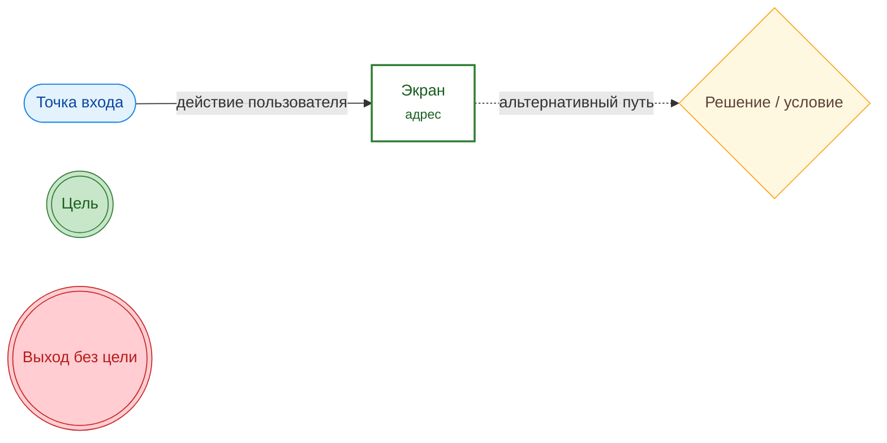
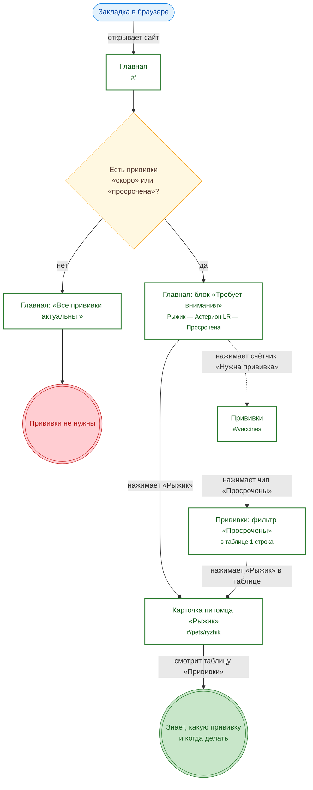
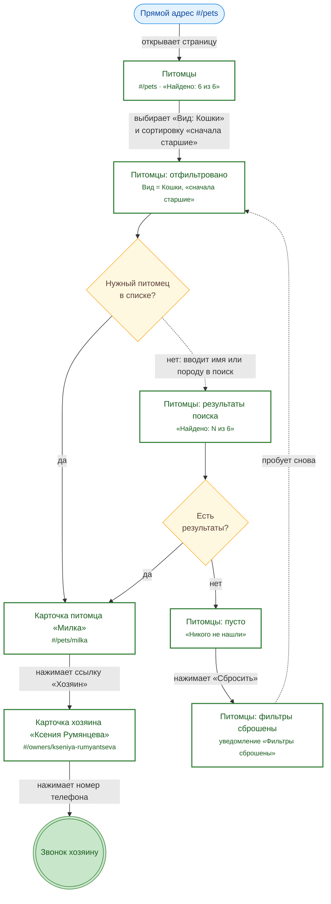

# 6. User-flow диаграммы

User flow показывает путь пользователя **по экранам** продукта от точки входа до достижения цели. Диаграммы построены для двух сценариев, каждый соответствует job story из раздела 3.

## Условные обозначения

| Фигура                           | Значение                                         |
| -------------------------------- | ------------------------------------------------ |
| Овал (синий)                     | Точка входа — откуда пользователь пришёл         |
| Прямоугольник (зелёная рамка)    | Экран или состояние экрана, с адресом            |
| Ромб (жёлтый)                    | Развилка: условие системы или выбор пользователя |
| Подпись на стрелке               | Действие пользователя (нажал, ввёл, выбрал)      |
| Сплошная стрелка                 | Основной путь (happy path)                       |
| Пунктирная стрелка               | Альтернативный путь                              |
| Двойной круг (зелёный / красный) | Цель достигнута / выход без цели                 |

---

## User flow 1. Проверить, кому нужна прививка

**Job story 1:** когда я планирую неделю, я хочу сразу увидеть, у кого скоро или просрочена прививка, чтобы вовремя записаться к ветеринару.
**Пользователь:** Иутинский Дмитрий, хозяин кота Рыжика.
**Цель:** узнать, какая прививка просрочена, и посмотреть дату последней.

**Шагов до цели:** 2 экрана по основному пути (Главная → Рыжик), 3 экрана по альтернативному (Главная → Прививки → Рыжик).

---

## User flow 2. Найти нужного питомца и связаться с хозяином

**Job story 3:** когда в базе много животных и я ищу конкретного, я хочу отфильтровать, найти по имени и отсортировать, чтобы за несколько секунд найти нужную карточку.
**Пользователь:** сотрудник ветклиники, работает с компьютера.
**Цель:** найти кошку Милку (имя сотрудник помнит неточно) и позвонить её хозяйке.

**Шагов до цели:** 3 экрана (Питомцы → Милка → Ксения Румянцева) по основному пути; при пустом поиске — возврат через «Сбросить».

---

## Сводка

| Flow | Job story         | Точка входа  | Экраны по основному пути   | Альтернативы и ошибки                      |
| ---- | ----------------- | ------------ | -------------------------- | ------------------------------------------ |
| 1    | Контроль прививок | Закладка     | Главная → Питомец          | через «Прививки» + фильтр; «все актуальны» |
| 2    | Поиск питомца     | Прямой адрес | Питомцы → Питомец → Хозяин | поиск; пустой результат и сброс            |
